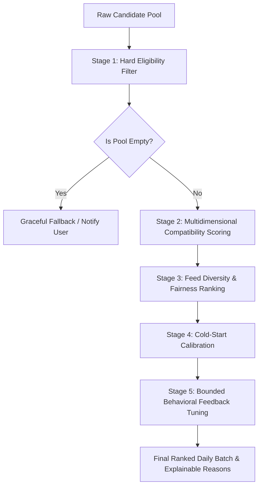

# Perspective: Research-Driven Onboarding & Matching Engine Specification

> **Date Researched:** October 17, 2026  
> **Target Product:** Perspective (18+ Social Feedback & Dating Application)  
> **Authors:** Principal Product Designer, Senior Mobile Architect, Backend & Recommendation Systems Lead  

---

## 1. Executive Summary

Perspective's core differentiator is its give-to-get feedback loop ("perspectives"). However, dating is the primary relationship use case. To maximize meaningful connections and long-term retention without forcing users through a 15-screen questionnaire, we researched the three category leaders—**Tinder**, **Hinge**, and **Bumble**—via their official documentation, help centers, press announcements, and privacy disclosures.

This document synthesizes:
1. **Competitor findings** with direct official citations.
2. **Patterns adopted vs. rejected** for Perspective with rigorous rationale.
3. **Comprehensive Data Dictionary** for all onboarding questions.
4. **End-to-End Recommendation Engine Specification** (5 stages: Eligibility, Compatibility Scoring, Ranking/Diversity, Cold-Start, Behavioral Updates).
5. **Measurement & Evaluation Plan**.

---

## 2. Deep Competitor Research

### A. Tinder Research

#### 1. Official Sources & Inquiries
- **Matching Methodology:** [Tinder Help: Powering Tinder — The Method Behind Our Matching](https://www.help.tinder.com/hc/en-us/articles/7606685697037-Powering-Tinder-The-Method-Behind-Our-Matching/) (Researched Oct 2026)
- **Interests Catalogue:** [Tinder Help: Interests](https://www.help.tinder.com/hc/en-us/articles/360046122691-Interests)
- **Discovery Settings:** [Tinder Help: Discovery Settings](https://www.help.tinder.com/hc/en-us/articles/115003340963-Discovery-Settings)
- **AI Matching & Product Direction:** [Tinder Newsroom: Tinder Sparks 2026](https://in.tinderpressroom.com/Tinder-Sparks-2026) & [AI-powered Matching](https://www.help.tinder.com/hc/en-us/articles/34723594883213-AI-powered-matching)
- **Photo-Based Suggestions:** [Tinder Help: Photo-Based Suggestions](https://www.help.tinder.com/hc/en-us/articles/33703773897357-Photo-Based-Suggestions)

#### 2. Publicly Documented Attributes & Mechanics
- **Interests Requirement:** Users must select a **minimum of 3 interests** to add them to their profile. Interests appear prominently as pill chips on the profile card in the exact selection sequence.
- **Relationship Goals:** Six structured options: *Long-term partner*, *Long-term, open to short*, *Short-term, open to long*, *Short-term fun*, *New friends*, *Still figuring it out*. Tinder periodically prompts users to verify that their goals haven't changed.
- **Lifestyle & Identity Tags:** Pets, drinking habits, smoking habits, workout frequency, zodiac sign, communication style, love styles, languages spoken.
- **Discovery Dealbreakers:** Maximum distance (km/mi) and age range can each be marked as a hard dealbreaker ("Only show people in this range").

#### 3. How Attributes Influence Recommendations
- **Recency & Active Status is #1:** Tinder explicitly states that being active on the app is the single most critical factor. The algorithm prioritizes currently active accounts and suppresses dormant ones.
- **Elo Score is Deprecated:** Tinder officially confirms the legacy "Elo score" (a global attractiveness hierarchy) is retired in favor of dynamic real-time contextual matching.
- **Photo-based Cues:** Tinder uses computer-vision visual embeddings from liked photos to recommend candidates with similar aesthetic styles.

#### 4. Explicit vs. Undisclosed & Privacy Considerations
- **Undisclosed:** Exact feature weights, rate-limiting thresholds, and the internal neural network structure behind photo embeddings.
- **Privacy:** Photo embeddings and activity patterns are processed internally without exposing raw biometric telemetry or exact GPS coordinates.

---

### B. Hinge Research

#### 1. Official Sources & Inquiries
- **Matching Algorithm:** [Hinge: How We Connect Daters](https://hinge.co/how-we-connect-daters) (Researched Oct 2026)
- **Automated Profiling & Decisions:** [Hinge Help: Automated Decision-Making and Profiling](https://help.hinge.co/hc/en-us/articles/360010956733-Automated-Decision-Making-and-Profiling-at-Hinge)
- **Dating Preferences & Dealbreakers:** [Hinge Help: Editing Dating Preferences](https://help.hinge.co/hc/en-us/articles/360011063294)
- **Signals Engagement Badge:** [Hinge Help: What is Signals](https://help.hinge.co/hc/en-us/articles/49858544145555-What-is-Signals)
- **Prompt Feedback Coaching:** [Hinge Newsroom: Prompt Feedback](https://hinge.co/newsroom/prompt-feedback)

#### 2. Publicly Documented Attributes & Mechanics
- **Gale-Shapley Adaptation:** Hinge adapts the Nobel-prize winning Gale-Shapley deferred-acceptance algorithm to predict *mutual likelihood* ("who is likely to like you back"), powering the daily **"Most Compatible"** recommendation.
- **Dating Intentions:** Relationship type (monogamous, non-monogamous, figuring it out) and dating goals (long-term relationship, life partner, short-term, casual).
- **Dealbreaker Separation:** Every preference (age, distance, religion, politics, family plans, drinking, smoking, marijuana, drugs) has an independent **"Is this a dealbreaker?"** toggle. Flexible preferences expand the candidate pool when matches are sparse.
- **Hinge Signals:** A badge highlighting daters who take time to read profiles past photo 1, send comments with likes, and reply meaningfully.
- **Prompt Feedback:** Real-time AI nudges alerting users against cliché or one-word answers.

#### 3. Explicit vs. Undisclosed & Privacy Considerations
- **Explicitly Documented:** Behavioral learning from "We Met" post-date surveys, dealbreaker logic, and mutual compatibility scoring.
- **Undisclosed:** The proprietary loss function and hyper-parameters of the Gale-Shapley matrix.
- **Privacy Disclosures:** Users can opt out of automated profiling under GDPR/CCPA. Sensitive traits (religion, politics) require explicit opt-in to display and filter.

---

### C. Bumble Research

#### 1. Official Sources & Inquiries
- **Filters & Preferences:** [Bumble Support: Using Filters to Set Your Preferences](https://support.bumble.com/hc/articles/28423691289629-Using-filters-to-set-your-preferences) (Researched Oct 2026)
- **Discover Tab:** [Bumble Support: Using the Discover Tab](https://support.bumble.com/hc/articles/28423668110621-Using-the-Discover-tab)
- **Interest Badges:** [Bumble Safety & Buzz: Filter by Interest Badges](https://www.safety.bumble.com/the-buzz/filter-by-interest-badges)
- **Privacy & Matching:** [Bumble Privacy Policy](https://bumble.com/privacy-policy/en)

#### 2. Publicly Documented Attributes & Mechanics
- **Basic Filters (Free):** Age, distance, photo verification status, known languages, and similar interests. Option to toggle *"Show other people if I run out"*.
- **Advanced Filters (Paid / Premium):** Height, exercise, education, star sign, dating intentions, religion, politics, smoking, drinking, and kids. A user can only filter on an advanced trait if they have provided that trait on their own profile.
- **Interest Badges:** Up to 5 badges from curated categories (Sports, Food & Drink, Creative, Values, Pets, Travel, etc.).
- **Discover Tab:** Daily 9 AM refresh highlighting shared communities, shared badges, and "Recommended for you" curated matches.

---

## 3. Comparative Synthesis: Adopted vs. Rejected Patterns for Perspective

| Pattern / Feature | Competitor | Perspective Decision | Architectural Rationale |
| :--- | :--- | :--- | :--- |
| **Minimum 3 Interests Selection** | Tinder, Bumble | **ADOPT** | 3 interests provide the mathematical minimum for meaningful Jaccard overlap ($J \ge 0.25$) without causing cognitive fatigue. |
| **Curated Multi-Category Taxonomy** | Tinder, Bumble | **ADOPT** | Canonical IDs across 8 high-signal categories (Creativity, Music, Outdoors & Active, Food & Drink, Entertainment, Knowledge & Tech, Vibe & Lifestyle, Community & Values) prevent fragmentation and messy free-text tagging. |
| **Separate Dealbreaker vs. Preference** | Hinge | **ADOPT** | Hard constraints (e.g. strict age limits) must filter in Stage 1; soft preferences gently bias Stage 2 scoring without zeroing the candidate pool. |
| **Mutual Intentions Compatibility Matrix** | Hinge, Tinder | **ADOPT** | Relationship goals (long-term, casual, figuring it out) are scored via an explainable compatibility matrix. Incompatible intentions reduce compatibility score but don't hard-crash discovery unless designated as a dealbreaker. |
| **Explainable Recommendations** | Hinge | **ADOPT** | Instead of opaque percentages ("94% match"), provide verifiable human justifications: *"You both love live music"*, *"Compatible dating intentions"*, *"Shared lifestyle pace"*. |
| **Gale-Shapley / Reciprocity Balancing** | Hinge | **ADOPT** | Integrates directly into Perspective's give-to-get philosophy: boost under-served profiles and balance mutual likelihood. |
| **Deprecation of Hidden "Elo" Scores** | Tinder | **ADOPT** | No global attractiveness scores or toxic desirability rankings. Perspective evaluates pairwise compatibility and freshness. |
| **Paywalled Dealbreakers & Basic Filters** | Bumble | **REJECT** | Basic dating eligibility, age, distance, and dealbreakers must be free and transparent. Gating safety or essential compatibility behind paywalls creates bad incentives. |
| **15-20 Screen Onboarding Wizards** | Various | **REJECT** | Fatigue causes drop-off. We adopt a tight **6-step progressive disclosure flow** (About You $\to$ Preferences $\to$ Interests $\to$ Intentions $\to$ Personality $\to$ Review). |
| **Inferring Sensitive Traits via AI** | Various | **REJECT** | Never infer politics, religion, sexual orientation, or race from photographs or free-text comments. |
| **Fake Compatibility Percentages** | Various | **REJECT** | No uncalibrated numbers like "98% compatible" without a statistically validated longitudinal ground truth. |

---

## 4. Comprehensive Data Dictionary

| Stable Field Name | Data Type | Allowed Values | Required / Optional | Visibility | Usage | Mutability | Sensitive? | Purpose & Rationale |
| :--- | :--- | :--- | :--- | :--- | :--- | :--- | :--- | :--- |
| `displayName` | `String` | 1–30 chars | Required | Public | Display | In profile settings | No | User's preferred first name. |
| `birthDate` | `Date` (ISO) | Valid date, 18+ | Required | Private | Eligibility (Age) | Immutable without support | Yes | Legal 18+ age verification; only derived age is public. |
| `gender` | `Enum` | `woman`, `man`, `non_binary` | Required | Public | Eligibility & Display | In profile settings | No | Discovery filter and profile presentation. |
| `pronouns` | `String` | Optional text (e.g. "she/her") | Optional | Public | Display | In profile settings | No | Respectful representation on profile. |
| `heightCm` | `Int` | 100–250 cm | Required | Public | Display | In profile settings | No | Stated physical baseline for perspective givers. |
| `city` | `String` | 2–80 chars | Required | Public | Display & Proximity | In profile settings | No | Broad locality; precise GPS is never stored or served. |
| `audienceGenders` | `Enum[]` | Array of `Gender` | Required | Private | Stage 1 Eligibility | In preferences | No | Who the user wants to see and who can see them. |
| `audienceMinAge` | `Int` | 18–100 | Required | Private | Stage 1 Eligibility | In preferences | No | Lower age bound for dating discovery. |
| `audienceMaxAge` | `Int` | 18–100 | Required | Private | Stage 1 Eligibility | In preferences | No | Upper age bound for dating discovery. |
| `datingIntention` | `Enum` | `long_term`, `long_term_open`, `short_term_open`, `casual`, `friendship`, `figuring_out` | Required | Public | Stage 2 Scoring & Display | In profile/prefs | No | Relationship goal alignment. |
| `intentionDealbreaker` | `Boolean` | `true`, `false` | Optional (default false) | Private | Stage 1 Eligibility | In preferences | No | If true, excludes candidates with conflicting goals. |
| `selectedInterests` | `String[]` | Canonical IDs from catalogue | Required (min 3, max 10) | Public | Stage 2 Scoring & Display | In profile edit | No | Shared passions and conversation starters. |
| `lifestylePace` | `Enum` | `early_bird`, `night_owl`, `balanced`, `active_adventurer`, `laid_back` | Optional | Public | Stage 2 Scoring & Display | In profile edit | No | Daily rhythm and lifestyle harmony. |
| `socialPreference` | `Enum` | `introvert`, `extrovert`, `ambivert`, `small_groups`, `social_butterfly` | Optional | Public | Stage 2 Scoring & Display | In profile edit | No | Social energy expectations. |
| `personalityPrompts` | `JSON / Relation` | Array of `{ promptId, responseText }` | Optional (1–3) | Public | Display & Self-expression | In profile edit | No | Personality nuance and rich visual profile cards. |
| `selfieStatus` | `Enum` | `unverified`, `verified`, `rejected` | Required | Public (Badge) | Stage 1 Eligibility | Re-verify on rejection | Yes (Private media) | Sybil/bot prevention and adult authentication. |

---

## 5. Recommendation Engine Specification

The recommendation pipeline runs deterministically on the backend in 5 sequential stages:

### Stage 1: Hard Eligibility Filtering
Candidates are strictly eliminated if any of the following apply:
1. `candidate.isLive !== true` or account status is suspended.
2. `candidate.id === viewer.id`.
3. Mutual block exists (`viewer.blockedIds.has(candidate.id) || candidate.blockedIds.has(viewer.id)`).
4. Mutual audience mismatch (`!mutuallyVisible(viewer, candidate)`: viewer gender $\notin$ candidate audience OR candidate gender $\notin$ viewer audience OR age outside bounds).
5. Hard dealbreaker violation: If viewer has `intentionDealbreaker === true`, candidate must share a compatible intention.
6. Viewer has already answered all active posts of the candidate.
7. Candidate has hit `MAX_PERSPECTIVES_RECEIVED_PER_DAY` (fairness cap).

### Stage 2: Compatibility Scoring Formula
For each eligible candidate $c$, calculate normalized component scores $S \in [0, 1]$:

$$\text{Compatibility}(v, c) = w_I \cdot S_{\text{interests}} + w_P \cdot S_{\text{preferences}} + w_D \cdot S_{\text{intentions}} + w_L \cdot S_{\text{lifestyle}}$$

#### Baseline Normalized Weights:
- **Shared Interests ($w_I = 0.40$):** Weighted Jaccard similarity:
  $$S_{\text{interests}}(v, c) = \frac{|I_v \cap I_c|}{|I_v \cup I_c|}$$
  If both users have zero interests recorded, $S_{\text{interests}} = 0.5$ (neutral unknown) with coverage penalized.
- **Dating Intentions ($w_D = 0.25$):** Compatibility matrix:
  - Exact match: $1.0$
  - Compatible adjacent (e.g. `long_term` with `long_term_open`): $0.85$
  - Exploratory (`figuring_out` with any): $0.60$
  - Opposing (e.g. `long_term` with `casual`): $0.15$
- **Explicit Preferences ($w_P = 0.20$):** Reciprocal age preference centeredness and height compatibility.
- **Lifestyle & Social Pace ($w_L = 0.15$):** Overlap in lifestyle rhythm and social energy.

#### Missing Data Handling:
If a user omits optional fields (e.g. lifestyle), the engine **renormalizes** the remaining active weights so missing data is never treated as negative hostility:
$$w_k' = \frac{w_k}{\sum_{j \in \text{available}} w_j}$$
Additionally, an internal **Data Coverage Index** ($C \in [0, 1]$) is recorded.

### Stage 3: Ranking, Reciprocity & Feed Diversity
Compatibility is balanced with network health and fairness:
$$\text{RankScore}(c) = \alpha \cdot \text{Compatibility}(v, c) + \beta \cdot \text{ReciprocityNeed}(c) + \gamma \cdot \text{Freshness}(c) - \delta \cdot \text{Penalties}(c)$$
- **Reciprocity Need:** $\frac{1}{1 + \text{recentReceivedPerspectives}}$ (ensures new/underserved profiles get seen).
- **Freshness:** $e^{-\frac{\text{ageDays}}{30}}$ (gives newly live profiles a welcoming boost).
- **Penalties:** Penalizes active reports ($0.1 \times \min(\text{reports}, 5)$).

### Stage 4: Cold-Start Behavior
For new users with zero interaction history:
- Pure explicit signals (Interests Jaccard + Dating Intention matrix).
- Reciprocity booster ensures their own profile is assigned as a **Boost Slot** in other active users' mandatory sets.
- Guaranteed minimum diversity: ensures the top 3 cards span distinct interest clusters.

### Stage 5: Behavioral Learning & Explainability
- **Verifiable Explanations:** When a card is surfaced, the engine returns truthful, human-readable match tags:
  - Shared interest overlap: *"You both love Live Music & Specialty Coffee"*
  - Intention alignment: *"Both looking for Long-Term Partner"*
  - Category resonance: *"High vibe compatibility"*
- **Adaptive Affinity:** Over time, positive interactions (giving a perspective marked helpful, sending a connect request) adjust the viewer's implicit interest weights using an exponential decay window ($\tau = 30\text{ days}$).

---

## 6. Measurement and KPIs

1. **Onboarding Funnel Completion:** Target $\ge 78\%$ completion from Step 1 to Review.
2. **Median Time to Complete:** Target $\le 2.5\text{ minutes}$.
3. **Interest Selection Engagement:** Mean interests selected $\ge 4.2$.
4. **Recommendation Quality:**
   - Perspective Given Rate per Served Profile $\ge 35\%$.
   - Connect Request Acceptance Rate $\ge 22\%$.
   - Ratio of profiles with zero perspectives at 24 hours $\le 4\%$.
5. **Fairness & Safety:**
   - Exposure Gini coefficient across profiles $\le 0.35$.
   - Decline rate on connect requests $\le 18\%$.

---
*End of Research & Technical Specification.*
